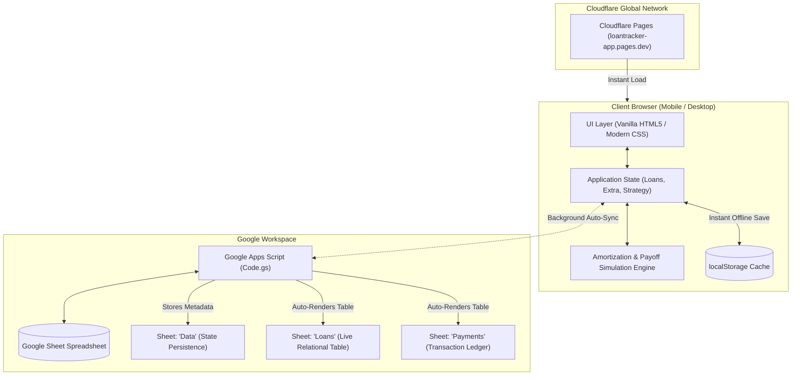

# 🏦 Loan Tracker (LNT)

> An ultra-lightweight, offline-first personal debt management web app with automated Google Sheets two-way sync, interactive debt payoff simulation (Avalanche vs. Snowball), and modern mobile-first UI physics.

[](https://loantracker-app.pages.dev)
[](https://loantracker-app.pages.dev)
[](https://sheets.new)
[](LICENSE)

---

## 🌟 Key Features

- **📱 Mobile-First Native Experience:** Responsive dark-themed fintech UI featuring Sora typography, safe-area insets, ambient neon orbs, 3D tilt perspective physics, and material click ripples.
- **🔄 Two-Way Google Sheets Database Sync:** Seamless real-time sync with Google Sheets via a Google Apps Script Web App. Edit in the app to update the sheet, or edit rows directly in Google Sheets to update the app.
- **⚡ Debt Accelerator Simulator:**
  - **Debt Avalanche (Highest Rate First):** Mathematically minimizes total interest paid across all loans.
  - **Debt Snowball (Smallest Loan First):** Eliminates balances quickly to free up monthly cash flow.
  - **Compound Rollover:** When a loan clears, its freed-up EMI automatically rolls into the next priority loan.
- **📊 Excel & CSV Power Tools:**
  - **Import:** Drag-and-drop or upload any `.xlsx`, `.xls`, or `.csv` spreadsheet file (powered by SheetJS).
  - **Export:** 1-click download of your complete loan balances and transaction ledger in Excel CSV format.
- **🎉 Gamified Visual Milestones:**
  - Real-time animated number counters for balances and interest saved.
  - Interactive SVG circular debt repayment ring.
  - Particle confetti celebration effects and haptic vibration feedback when paying EMIs or closing debts.
- **📲 1-Click Multi-Device Pairing:** Generate a secure pairing link from the Settings tab to sync phones, tablets, and laptops instantly without re-typing credentials.
- **🧹 Atomic Two-Way Reset & Deletion:** "Reset All" clears local storage and wipes the connected Google Sheet tables simultaneously. Deleting rows in Google Sheets automatically purges them from the app.

---

## 🏗️ Architecture & Data Flow



---

## 🚀 Live Demo

The application is deployed live and globally accessible:

🔗 **[https://loantracker-app.pages.dev](https://loantracker-app.pages.dev)**

---

## 📂 Project Structure

```
LNT/
├── loan-tracker-netlify/
│   ├── index.html            # Core SPA (CSS, HTML, JS, SheetJS, Animation Engine)
│   ├── netlify.toml          # Static site configuration
│   └── google-sheet/
│       └── Code.gs           # Google Apps Script two-way scanner & database API
├── .gitignore                # Git ignore rules (wrangler cache, temp files)
└── README.md                 # Project documentation
```

---

## 🛠️ Getting Started & Setup Guide

### Option 1: Using the Live Web App

1. Visit **[https://loantracker-app.pages.dev](https://loantracker-app.pages.dev)**.
2. Tap **"+ Add"** or **"Try sample data"** to start tracking your loans.
3. Switch to the **Settings** tab to link your personal Google Sheet or export data.

---

### Option 2: Connecting Your Own Google Sheet

To use a Google Sheet as your personal database backend:

1. **Create a Google Sheet:**
   - Open [sheets.new](https://sheets.new) in your browser.
   - Name it `Loan Tracker DB`.

2. **Add Apps Script:**
   - In Google Sheets, click **Extensions** > **Apps Script**.
   - Paste the contents of [`loan-tracker-netlify/google-sheet/Code.gs`](loan-tracker-netlify/google-sheet/Code.gs) into the editor.
   - *(Optional)* Update `const SECRET = 'your_passphrase';` at the top of the file.
   - Click **Save** (`Ctrl + S`).

3. **Deploy as Web App:**
   - Click **Deploy** > **New deployment**.
   - Select type: **Web app**.
   - Configure:
     - **Execute as:** `Me (your email)`
     - **Who has access:** `Anyone` *(Required for browser CORS communication)*
   - Click **Deploy** and complete the authorization prompt.
   - Copy the generated Web App URL (`https://script.google.com/macros/s/.../exec`).

4. **Connect in App:**
   - Open **[https://loantracker-app.pages.dev](https://loantracker-app.pages.dev)**.
   - Go to **Settings** > **Google Sheet sync**.
   - Paste your Web App URL and passphrase.
   - Click **Save and sync**.

---

### Option 3: Deploying to Cloudflare Pages via CLI

If you want to host your own instance of the frontend:

```bash
# Clone the repository
git clone https://github.com/adityanimkar/Loan-tracker-.git
cd Loan-tracker-

# Login to Cloudflare Wrangler
npx wrangler login

# Create a Cloudflare Pages project
npx wrangler pages project create my-loan-tracker --production-branch main

# Deploy the static directory
npx wrangler pages deploy loan-tracker-netlify --project-name my-loan-tracker
```

---

## 🧮 Mathematical Engine & Formulas

### Monthly Amortization
Reducing-balance compounding calculated on a 30-day basis:

$$I_{\text{month}} = \text{Balance} \times \frac{\text{Annual Rate}}{100 \times 12} = \text{Balance} \times \frac{\text{Annual Rate}}{1200}$$

$$\text{Principal Reduction} = \text{EMI} - I_{\text{month}}$$

$$\text{New Balance} = \max\left(0, \text{Balance} - \text{Principal Reduction}\right)$$

### Prepayment Acceleration
When a lump-sum prepayment $A$ is recorded:
$$\text{New Balance} = \max\left(0, \text{Balance} - A\right)$$
Prepayments directly reduce the principal balance without penalty, cutting down tenure and cumulative interest exponentially.

---

## 💻 Tech Stack

| Layer | Technology |
| :--- | :--- |
| **Frontend** | Pure HTML5, CSS3 Custom Properties, Modern JavaScript (ES6+) |
| **Styling & Physics** | Native CSS Animations, Canvas 2D Confetti, 3D Perspective Transforms |
| **Spreadsheet Engine** | SheetJS (`xlsx.full.min.js`) for local `.xlsx`/`.csv` parsing |
| **Database & Cloud API** | Google Apps Script (Serverless JavaScript on Google Workspace) |
| **Hosting & Edge CDN** | Cloudflare Pages (Global Low-Latency Edge Network) |

---

## 📄 License

This project is licensed under the [MIT License](LICENSE).
